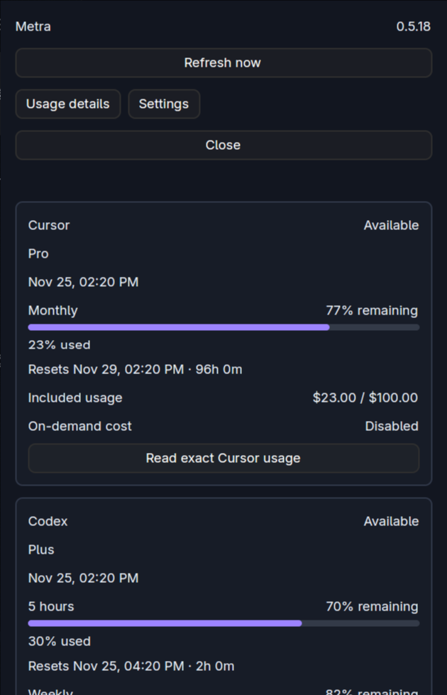
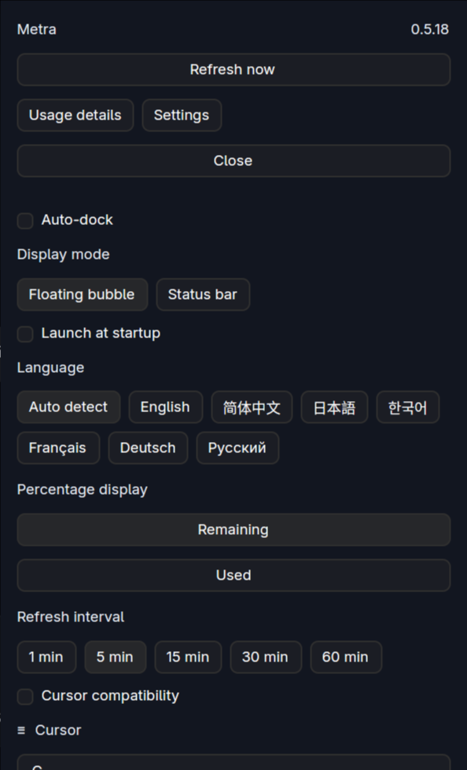

# Metra

[English](README.md) · [简体中文](README.zh-CN.md) · [日本語](README.ja.md) · [한국어](README.ko.md) · [Français](README.fr.md) · **Deutsch** · [Русский](README.ru.md)

## Überblick

**Die Nutzung Ihrer KI-Codingtools auf einen Blick.**

Limits, Tokens und Kosten von Cursor, Codex und Claude Code in einer kleinen Desktop-Anzeige. Für **macOS, Windows und Linux**.

- **Immer im Blick.** Blase frei verschieben, am Rand andocken oder die Statusleiste nutzen.
- **Drei Tools, ein Ort.** Verfügbare Limits, Rücksetzzeiten und Nutzung schnell prüfen.
- **Nach Ihren Wünschen.** Reihenfolge, Beschriftungen, Farben und Intervalle anpassen. Sieben Sprachen mit automatischer Erkennung.

Die Desktop-Oberfläche verwendet GPUI und GPUI Kit ohne WebView-Laufzeit.

| Nutzungsdetails | Anzeigeeinstellungen |
| :---: | :---: |
|  |  |

Aktuelle Oberfläche mit simulierten Daten, ohne echte Kontoinformationen. Verfügbare Daten hängen vom Anbieter und der Anmeldung ab.

## Erste Schritte

**[Neueste Version herunterladen](https://github.com/eyotang/Metra/releases/latest)**

| System | Datei | Installation |
| --- | --- | --- |
| macOS | `*-macos-universal.dmg` | DMG öffnen und Metra nach Applications ziehen. |
| Windows x64 | `*-windows-x64-setup.exe` | Installer starten oder die portable EXE verwenden. |
| Linux x64 | `*-linux-x64.deb` | Mit `sudo apt install ./Metra-*-linux-x64.deb` installieren. |

Unter macOS nach dem Verschieben nach Applications vor dem ersten Start ausführen, um das Quarantäneattribut zu entfernen:

```sh
sudo xattr -dr com.apple.quarantine /Applications/Metra.app
```

Beim Wechsel von einer Ad-hoc-signierten Version zu einer mit Developer ID signierten Version kann der Schlüsselbund erneut um Erlaubnis bitten. Wählen Sie für Metra **Immer erlauben**, damit spätere Versionen desselben Entwicklerteams auf diesen Eintrag zugreifen können.

Metra starten, bei den verwendeten Tools anmelden und auf die Blase klicken. Für genaue Cursor-Daten die **Cursor-Kompatibilität** in den Einstellungen aktivieren und dem Lesen lokaler Zugangsdaten zustimmen. Die Blase lässt sich ziehen und mit automatischem Andocken am Rand einklappen.

Sprache, Aktualisierungsintervall und Autostart in den Einstellungen ändern. Das Schließen eines Panels lässt Metra weiterlaufen; über Einstellungen oder Tray-Menü beenden.

Metra sucht beim Start und anschließend täglich nach Updates, solange es läuft. Ein Punkt auf der schwebenden Blase und ein Eintrag im Tray-Menü weisen auf eine neue Version hin. Im Nutzungsfenster kannst du auch **Nach Updates suchen** auswählen. Die installierte Version für Windows x64 kann signierte Updates direkt in Metra einspielen. Die portable Windows-Version sowie macOS und Linux öffnen die GitHub-Release-Seite zur manuellen Installation.

[Linux-Einrichtung](docs/linux.md) · [Omarchy-Widget](integrations/omarchy/README.md)

## Entwickeln und beitragen

**Node.js 24+**, **stabiles Rust** und die folgenden Systemtools installieren. Repository forken, eigenen Fork klonen und im Stammverzeichnis ausführen:

| System | Werkzeuge |
| --- | --- |
| macOS | Xcode-Kommandozeilenwerkzeuge |
| Windows | Visual Studio C++ Buildtools, Windows SDK |
| Linux | Clang, CMake, pkg-config, Fontconfig, XKB, Wayland, Vulkan; X11/XWayland |

```sh
npm ci
npm run dev
```

Vor dem Einreichen einer PR:

```sh
npm run check
npm test
npm run test:ui
```

UI: `desktop-gpui/src/`; Datenerfassung: `src/providers/`; Aktualisierung: `src/service.rs`. `METRA_CONFIG_DIR` trennt Testeinstellungen von Ihren eigenen.

Jede PR auf ein Problem beschränken und Problem, Änderung und Prüfung beschreiben. Bei UI-Änderungen Screenshots beifügen; betroffene Übersetzungen und README-Dateien in allen sieben Sprachen aktualisieren.

Unter macOS speichert Metra das importierte Cursor-Anmeldetoken in einem eigenen Systemschlüsselbund-Eintrag und im Arbeitsspeicher. Bei Tokenänderungen oder fehlgeschlagener Authentifizierung wird es erneut importiert; beim Abmelden von Cursor oder Deaktivieren des Kompatibilitätsmodus wird der Cache gelöscht. Cursors Entschlüsselungsschlüssel wird nicht kopiert; Zugangsdaten erscheinen weder in Einstellungsdateien noch in Protokollen.

Cursor-Nutzungsdaten verwenden bevorzugt die CLI-Anmeldung und bei fehlenden oder abgelehnten Zugangsdaten die Desktop-App. Unter Windows entschlüsselt Metra das Token der Desktop-App mit dem aktuellen Windows-Konto. Schlägt die Entschlüsselung fehl, zeigt Metra den Fehler an und behält die zuletzt erfolgreich abgerufenen Nutzungsdaten.

Lokale macOS-Installation: einmal `npm run setup:local-signing`, danach `npm run build` und `npm run install:local`. Verwenden Sie bei Updates dieselbe Signaturidentität, damit der Schlüsselbundzugriff an Metra gebunden bleibt.

[Referenz für Build, Pakete und Kollektor](docs/development.md) · [Issues](https://github.com/eyotang/Metra/issues) · [Pull requests](https://github.com/eyotang/Metra/pulls)

[MIT-Lizenz.](LICENSE)
