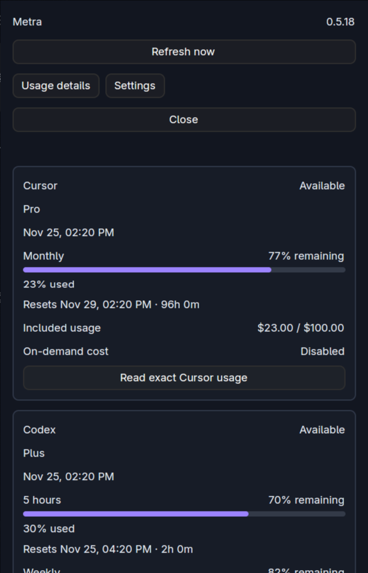
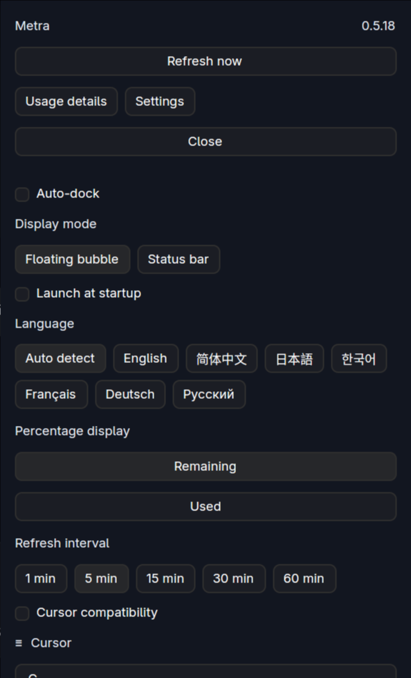

# Metra

[English](README.md) · [简体中文](README.zh-CN.md) · [日本語](README.ja.md) · [한국어](README.ko.md) · **Français** · [Deutsch](README.de.md) · [Русский](README.ru.md)

## Présentation

**Votre utilisation des outils de code IA, en un coup d’œil.**

Gardez les limites, tokens et coûts de Cursor, Codex et Claude Code dans un coin du bureau. Disponible sur **macOS, Windows et Linux**.

- **Toujours à portée de vue.** Déplacez la bulle, ancrez-la au bord ou choisissez la barre d’état.
- **Trois outils, un seul endroit.** Consultez les limites disponibles, les réinitialisations et l’utilisation.
- **À votre façon.** Personnalisez l’ordre, les libellés, les couleurs et l’actualisation. Sept langues avec détection automatique.

L’interface utilise GPUI et GPUI Kit, sans moteur WebView.

| Détails d’utilisation | Paramètres d’affichage |
| :---: | :---: |
|  |  |

Interface actuelle avec données simulées, sans informations de compte réelles. Les données disponibles dépendent du service et du mode de connexion.

## Premiers pas

**[Télécharger la dernière version](https://github.com/eyotang/Metra/releases/latest)**

| Système | Fichier | Installation |
| --- | --- | --- |
| macOS | `*-macos-universal.dmg` | Ouvrez le DMG et glissez Metra dans Applications. |
| Windows x64 | `*-windows-x64-setup.exe` | Lancez l’installateur ou utilisez l’EXE portable. |
| Linux x64 | `*-linux-x64.deb` | Installez avec `sudo apt install ./Metra-*-linux-x64.deb`. |

Sur macOS, après avoir déplacé l’application dans Applications, exécutez avant le premier lancement pour supprimer l’attribut de quarantaine :

```sh
sudo xattr -dr com.apple.quarantine /Applications/Metra.app
```

Lors du passage d’une version à signature ad hoc à une version signée avec Developer ID, le trousseau peut redemander une autorisation. Choisissez **Toujours autoriser** pour Metra afin que les versions suivantes signées par la même équipe conservent l’accès à cet élément.

Lancez Metra, connectez-vous aux outils utilisés, puis cliquez sur la bulle. Pour les données Cursor exactes, activez la **compatibilité Cursor** dans les paramètres et autorisez la lecture des identifiants locaux. Déplacez la bulle par glisser-déposer ; l’ancrage automatique la replie au bord de l’écran.

Réglez la langue, l’actualisation et le lancement au démarrage dans les paramètres. Fermer un panneau laisse Metra actif ; quittez via les paramètres ou le menu de la zone de notification.

Metra recherche les mises à jour au démarrage, puis une fois par jour tant qu’il est actif. Un point sur la bulle flottante et une entrée dans le menu de la zone de notification signalent une nouvelle version. Vous pouvez aussi sélectionner **Rechercher des mises à jour** dans le panneau d’utilisation. La version installée de Windows x64 peut appliquer les mises à jour signées dans Metra. La version portable de Windows, macOS et Linux ouvrent la page de publication GitHub pour une installation manuelle.

[Configuration Linux](docs/linux.md) · [Widget Omarchy](integrations/omarchy/README.md)

## Développer et contribuer

Installez **Node.js 24+**, **Rust stable** et les outils ci-dessous. Créez un fork, clonez-le et exécutez à sa racine :

| Système | Outils |
| --- | --- |
| macOS | Outils en ligne de commande Xcode |
| Windows | Outils C++ Visual Studio, Windows SDK |
| Linux | Clang, CMake, pkg-config, Fontconfig, XKB, Wayland, Vulkan; X11/XWayland |

```sh
npm ci
npm run dev
```

Avant de soumettre une PR :

```sh
npm run check
npm test
npm run test:ui
```

Commencez dans `desktop-gpui/src/` pour l’interface, `src/providers/` pour les collecteurs et `src/service.rs` pour l’actualisation. `METRA_CONFIG_DIR` isole les paramètres de test.

Gardez chaque PR ciblée : expliquez le problème, la modification et les vérifications. Ajoutez des captures pour les changements visuels et synchronisez les sept traductions et README concernés.

Sur macOS, Metra conserve le token Cursor importé dans sa propre entrée du trousseau système et en mémoire. Il le réimporte si le token local change ou si l’authentification échoue, et efface le cache à la déconnexion de Cursor ou à la désactivation du mode de compatibilité. La clé de déchiffrement de Cursor n’est pas copiée ; les identifiants ne figurent jamais dans les paramètres ni les journaux.

Les données Cursor utilisent en priorité la connexion CLI, avec repli sur l’application de bureau si elle est indisponible ou refusée. Sous Windows, Metra utilise le compte Windows actif pour déchiffrer le jeton de l’application de bureau. En cas d’échec du déchiffrement, Metra affiche l’erreur et conserve les dernières données d’utilisation récupérées.

Installation locale macOS : exécutez une fois `npm run setup:local-signing`, puis `npm run build` et `npm run install:local`. Réutilisez la même identité de signature lors des mises à jour pour lier l’accès au trousseau à Metra.

[Référence de compilation, distribution et collecte](docs/development.md) · [Issues](https://github.com/eyotang/Metra/issues) · [Pull requests](https://github.com/eyotang/Metra/pulls)

[Licence MIT.](LICENSE)
