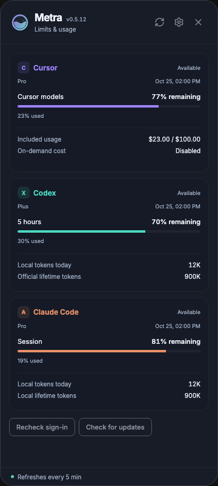
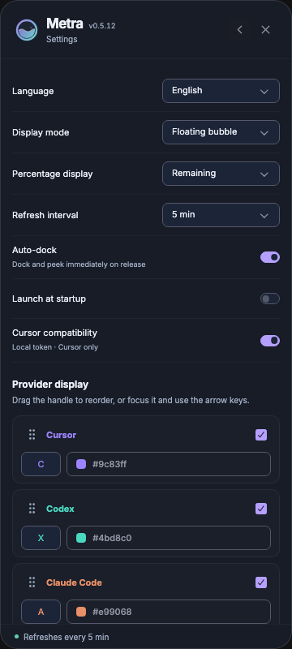

# Metra

[English](README.md) · [简体中文](README.zh-CN.md) · [日本語](README.ja.md) · [한국어](README.ko.md) · **Français** · [Deutsch](README.de.md) · [Русский](README.ru.md)

## Présentation

**Votre utilisation des outils de code IA, en un coup d’œil.**

Gardez les limites, tokens et coûts de Cursor, Codex et Claude Code dans un coin du bureau. Disponible sur **macOS, Windows et Linux**.

- **Toujours à portée de vue.** Déplacez la bulle, ancrez-la au bord ou choisissez la barre d’état.
- **Trois outils, un seul endroit.** Consultez les limites disponibles, les réinitialisations et l’utilisation.
- **À votre façon.** Personnalisez l’ordre, les libellés, les couleurs et l’actualisation. Sept langues avec détection automatique.

| Détails d’utilisation | Paramètres d’affichage |
| :---: | :---: |
|  |  |

Interface actuelle avec données simulées, sans informations de compte réelles. Les données disponibles dépendent du service et du mode de connexion.

## Premiers pas

**[Télécharger la dernière version](https://github.com/eyotang/Metra/releases/latest)**

| Système | Fichier | Installation |
| --- | --- | --- |
| macOS | `*-macos-universal.dmg` | Ouvrez le DMG et glissez Metra dans Applications. |
| Windows x64 | `*-windows-x64-setup.exe` | Lancez l’installateur ; l’EXE portable nécessite WebView2. |
| Linux x64 | `*-linux-x64.deb` | Installez avec `sudo apt install ./Metra-*-linux-x64.deb`. |

Sur macOS, après avoir déplacé l’application dans Applications, exécutez avant le premier lancement pour supprimer l’attribut de quarantaine :

```sh
sudo xattr -dr com.apple.quarantine /Applications/Metra.app
```

Lancez Metra, connectez-vous aux outils utilisés, puis cliquez sur la bulle. Pour les données Cursor exactes, activez la **compatibilité Cursor** dans les paramètres et autorisez la lecture des identifiants locaux. Déplacez la bulle par glisser-déposer ; l’ancrage automatique la replie au bord de l’écran.

Réglez la langue, l’actualisation et le lancement au démarrage dans les paramètres. Fermer un panneau laisse Metra actif ; quittez via les paramètres ou le menu de la zone de notification.

[Configuration Linux](docs/linux.md) · [Widget Omarchy](integrations/omarchy/README.md)

## Développer et contribuer

Installez **Node.js 24+**, **Rust stable** et les outils ci-dessous. Créez un fork, clonez-le et exécutez à sa racine :

| Système | Outils |
| --- | --- |
| macOS | Outils en ligne de commande Xcode |
| Windows | Outils C++ Visual Studio, Windows SDK, WebView2 |
| Linux | WebKitGTK 4.1, GTK 3, AppIndicator ; X11/XWayland pour les fenêtres flottantes |

```sh
npm ci
npm run dev
```

Avant de soumettre une PR :

```sh
npm run check
cargo test --locked --all-targets
npx playwright install chromium webkit
npm run test:ui
```

Commencez dans `frontend/` pour l’interface, `src/providers/` pour les collecteurs et `src/service.rs` pour l’actualisation. `METRA_CONFIG_DIR` isole les paramètres de test.

Gardez chaque PR ciblée : expliquez le problème, la modification et les vérifications. Ajoutez des captures pour les changements visuels et synchronisez les sept traductions et README concernés.

Installation locale macOS : `npm run build`, puis `npm run install:local`.

[Référence de compilation, distribution et collecte](docs/development.md) · [Issues](https://github.com/eyotang/Metra/issues) · [Pull requests](https://github.com/eyotang/Metra/pulls)

[Licence MIT.](LICENSE)
