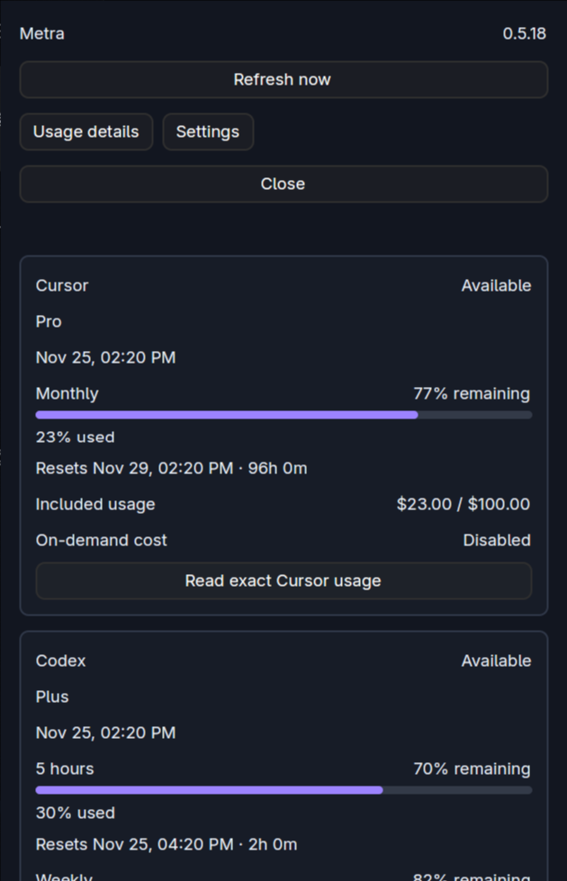
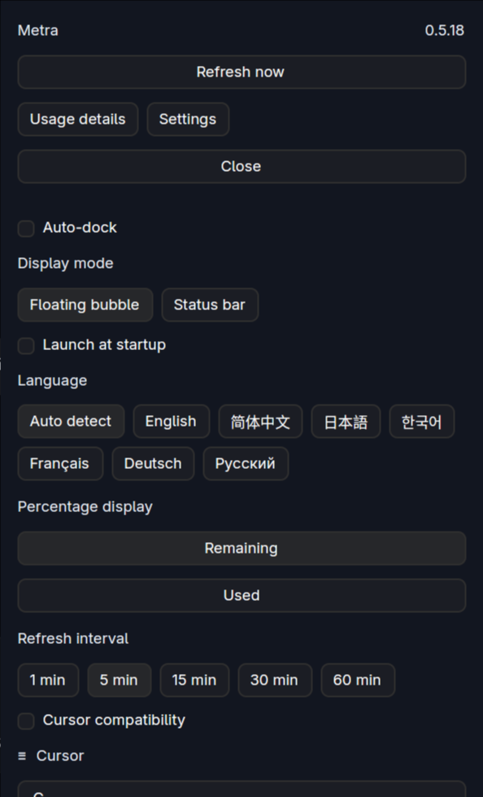

# Metra

[English](README.md) · [简体中文](README.zh-CN.md) · **日本語** · [한국어](README.ko.md) · [Français](README.fr.md) · [Deutsch](README.de.md) · [Русский](README.ru.md)

## ソフトウェア紹介

**AI コーディングの使用量を、ひと目で。**

Cursor、Codex、Claude Code の上限・トークン・費用をデスクトップの片隅に。**macOS・Windows・Linux** に対応。

- **作業を止めずに確認。** バブルを自由に移動し、画面端に収納。ステータスバー表示も選べます。
- **3つのツールを1か所で。** 利用可能な上限、リセット時刻、使用状況を確認。
- **自分好みに。** 表示順、ラベル、色、更新間隔を調整。7言語と自動検出に対応。

デスクトップ UI は GPUI と GPUI Kit を使用し、WebView ランタイムは不要です。

| 使用量の詳細 | 表示設定 |
| :---: | :---: |
|  |  |

現在の画面を模擬データで表示しています。実際のアカウント情報は含みません。取得できる情報はサービスとログイン方法により異なります。

## 使い方

**[最新版をダウンロード](https://github.com/eyotang/Metra/releases/latest)**

| OS | ファイル | インストール |
| --- | --- | --- |
| macOS | `*-macos-universal.dmg` | DMG を開き、Metra を Applications にドラッグ。 |
| Windows x64 | `*-windows-x64-setup.exe` | インストーラーを実行するか、ポータブル EXE を使用してください。 |
| Linux x64 | `*-linux-x64.deb` | `sudo apt install ./Metra-*-linux-x64.deb` でインストール。 |

macOS：Applications に移動後、初回起動前に以下を実行し、隔離属性を削除します。

```sh
sudo xattr -dr com.apple.quarantine /Applications/Metra.app
```

Metra を起動し、利用するツールにログインして、バブルをクリックすると使用量を確認できます。Cursor の正確な使用量には、設定で **Cursor 互換モード** を有効にし、ローカル認証情報の読み取りに同意してください。ドラッグで移動し、自動吸着を有効にすると画面端に収納できます。

設定で言語、更新間隔、自動起動を変更できます。パネルを閉じても動作は継続します。終了は設定またはトレイメニューから。

[Linux 設定](docs/linux.md) · [Omarchy ウィジェット](integrations/omarchy/README.md)

## 開発・貢献ガイド

**Node.js 24+**、**安定版 Rust** と下記の開発ツールを用意します。リポジトリを Fork してクローンし、ルートで実行：

| OS | 開発ツール |
| --- | --- |
| macOS | Xcode コマンドラインツール |
| Windows | Visual Studio C++ ビルドツール、Windows SDK |
| Linux | Clang, CMake, pkg-config, Fontconfig, XKB, Wayland, Vulkan; X11/XWayland |

```sh
npm ci
npm run dev
```

PR の提出前に確認：

```sh
npm run check
npm test
npm run test:ui
```

UI は `desktop-gpui/src/`、収集処理は `src/providers/`、更新処理は `src/service.rs` から。`METRA_CONFIG_DIR` でテスト設定を分離できます。

PR は1つの課題に絞り、理由・変更内容・検証方法を記載してください。UI 変更にはスクリーンショットを添付し、関連する翻訳と README は7言語を同期してください。

macOS では、取り込んだ Cursor のログイントークンを Metra 専用のシステムキーチェーン項目とメモリに保存します。ローカルトークンの変更や認証失効時に再取得し、Cursor のログアウトや互換モードの無効化時に削除します。Cursor の復号鍵はコピーせず、認証情報を設定ファイルやログに記録しません。

Cursor の使用量取得は CLI のログインを優先し、利用不可または認証失敗時にはデスクトップアプリに切り替えます。Windows では、現在の Windows アカウントでデスクトップ版のトークンを復号します。復号に失敗するとエラーを表示し、前回取得できた使用量を保持します。

macOS へのローカルインストールは、初回のみ `npm run setup:local-signing` を実行し、その後 `npm run build` と `npm run install:local` を実行します。更新時も同じ署名 ID を使い、キーチェーンの許可を Metra に紐付けます。

[ビルド・パッケージ・コレクターの詳細](docs/development.md) · [Issues](https://github.com/eyotang/Metra/issues) · [Pull requests](https://github.com/eyotang/Metra/pulls)

[MIT ライセンス。](LICENSE)
