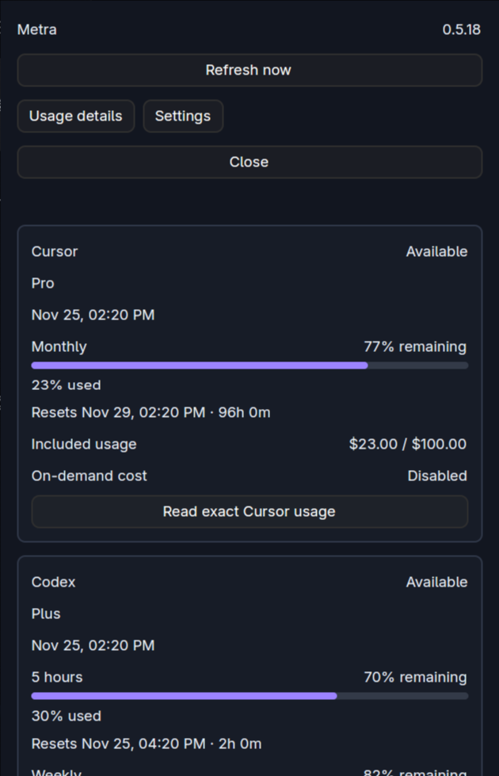
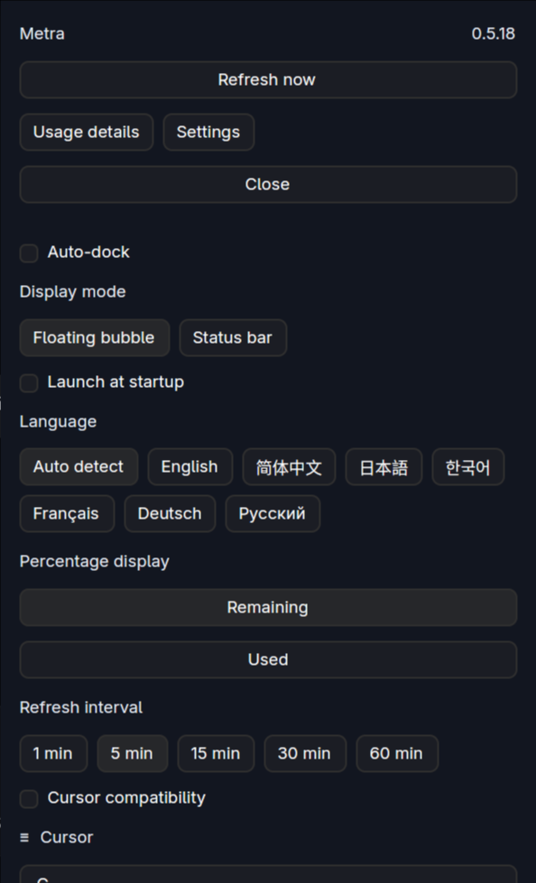

# Metra

[English](README.md) · [简体中文](README.zh-CN.md) · [日本語](README.ja.md) · [한국어](README.ko.md) · [Français](README.fr.md) · [Deutsch](README.de.md) · **Русский**

## О приложении

**Использование инструментов ИИ для кода — с первого взгляда.**

Лимиты, токены и стоимость Cursor, Codex и Claude Code в небольшом виджете на рабочем столе. Для **macOS, Windows и Linux**.

- **Всегда под рукой.** Перемещайте виджет, закрепляйте у края экрана или используйте строку состояния.
- **Три инструмента в одном месте.** Проверяйте доступные лимиты, время сброса и использование.
- **Настройте под себя.** Меняйте порядок сервисов, подписи, цвета и интервал обновления. Семь языков с автоматическим определением.

Интерфейс использует GPUI и GPUI Kit без среды WebView.

| Данные использования | Настройки отображения |
| :---: | :---: |
|  |  |

Текущий интерфейс с демонстрационными данными, без реальных сведений об аккаунтах. Доступные данные зависят от сервиса и способа входа.

## Как начать

**[Скачать последнюю версию](https://github.com/eyotang/Metra/releases/latest)**

| Система | Файл | Установка |
| --- | --- | --- |
| macOS | `*-macos-universal.dmg` | Откройте DMG и перенесите Metra в Applications. |
| Windows x64 | `*-windows-x64-setup.exe` | Запустите установщик или используйте переносимый EXE. |
| Linux x64 | `*-linux-x64.deb` | Установите: `sudo apt install ./Metra-*-linux-x64.deb`. |

В macOS после переноса в Applications, перед первым запуском выполните команду для удаления атрибута карантина:

```sh
sudo xattr -dr com.apple.quarantine /Applications/Metra.app
```

Запустите Metra, войдите в используемые инструменты и нажмите на виджет. Для точных данных Cursor включите **совместимость Cursor** в настройках и разрешите чтение локальных учётных данных. Перетаскивайте виджет; автозакрепление сворачивает его у края экрана.

В настройках меняются язык, интервал обновления и автозапуск. Закрытие панели оставляет Metra работать; для выхода используйте настройки или меню в трее.

Metra проверяет обновления при запуске и затем раз в день, пока приложение работает. Точка на плавающем индикаторе и пункт в меню системного лотка сообщают о новой версии. Проверку также можно запустить вручную кнопкой **Проверить обновления** на панели использования. Установленная версия для Windows x64 может применять подписанные обновления прямо в Metra. Переносная версия для Windows, macOS и Linux открывают страницу выпуска на GitHub для ручной установки.

[Настройка Linux](docs/linux.md) · [Виджет Omarchy](integrations/omarchy/README.md)

## Разработка и участие

Установите **Node.js 24+**, **стабильный Rust** и инструменты ниже. Создайте форк репозитория, клонируйте его и выполните в корне:

| Система | Инструменты |
| --- | --- |
| macOS | Инструменты командной строки Xcode |
| Windows | Инструменты сборки Visual Studio C++, Windows SDK |
| Linux | Clang, CMake, pkg-config, Fontconfig, XKB, Wayland, Vulkan; X11/XWayland |

```sh
npm ci
npm run dev
```

Перед отправкой PR:

```sh
npm run check
npm test
npm run test:ui
```

Интерфейс: `desktop-gpui/src/`; сбор данных: `src/providers/`; обновление: `src/service.rs`. `METRA_CONFIG_DIR` позволяет отделить тестовые настройки.

Один PR — одна задача: опишите проблему, изменение и проверку. Для изменений интерфейса приложите скриншоты; обновите затронутые переводы и README на всех семи языках.

В macOS Metra сохраняет импортированный токен Cursor в собственной записи системной Связки ключей и в памяти. При изменении локального токена или сбое аутентификации он импортируется заново; выход из Cursor или отключение режима совместимости очищает кэш. Ключ расшифровки Cursor не копируется; учётные данные не попадают в файлы настроек и журналы.

Для данных Cursor приоритетен вход через CLI. Если учётные данные недоступны или отклонены, используется настольное приложение. В Windows Metra расшифровывает токен настольного приложения с помощью текущей учётной записи Windows. Если расшифровка не удалась, Metra показывает ошибку и сохраняет данные о последнем успешном обновлении.

Локальная установка macOS: один раз выполните `npm run setup:local-signing`, затем `npm run build` и `npm run install:local`. При обновлениях используйте ту же подпись, чтобы доступ к Связке ключей оставался привязан к Metra.

[Справочник по сборке, пакетам и сборщику данных](docs/development.md) · [Issues](https://github.com/eyotang/Metra/issues) · [Pull requests](https://github.com/eyotang/Metra/pulls)

[Лицензия MIT.](LICENSE)
